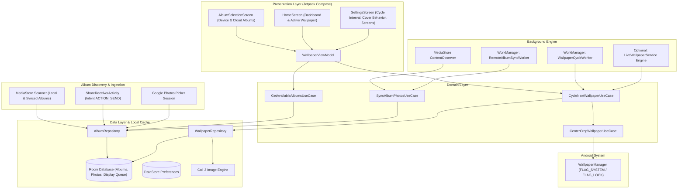

# Android Background Switcher: Architecture & Implementation Plan (v2)

## 1. Executive Summary & Album Discovery Strategy

The app automatically discovers and displays albums directly inside the app **without requiring the user to copy or paste any links**:

```
+---------------------------------------------------------------------------------------------------+
| ALBUM SELECTION & DISCOVERY ARCHITECTURE                                                          |
+------------------------------------+--------------------------+-----------------------------------+
| Mechanism                          | In-App Album UI?         | New Photo Background Discovery    |
+------------------------------------+--------------------------+-----------------------------------+
| 1. Native MediaStore (Device/Sync) | YES (Auto-detected list) | 100% Real-Time (ContentObserver)  |
| 2. Google Photos Direct Share      | YES (One-tap from Photos)| 100% Background Sync (Worker)     |
| 3. Google Photos Picker API        | YES (System Cloud Picker)| Scoped to user picking session    |
| 4. Google Drive Cloud Folders      | YES (In-app folder tree) | 100% Background Sync (Changes API)|
+------------------------------------+--------------------------+-----------------------------------+
```

### How Android Native Album Functionality Works
1. **Native On-Device / Google Photos Synced Albums (`MediaStore`)**:
   * Android provides a built-in media catalog through `MediaStore.Images.Media`.
   * The app queries `BUCKET_DISPLAY_NAME` and `BUCKET_ID` to automatically enumerate **all photo albums** on the device (Camera, Google Photos device folders, Downloads, Screenshots, etc.).
   * The app presents a native Compose screen listing all albums with thumbnail previews and photo counts.
   * **Zero User Intervention for New Photos**: The app registers a `ContentObserver` and `WorkManager` job on `MediaStore.Images.Media.EXTERNAL_CONTENT_URI`. Whenever the user takes a photo or a synced folder receives new pictures, the app detects it automatically in the background.

2. **Google Photos Cloud-Only Albums (One-Tap Direct Share Sheet)**:
   * Google's security overhaul (March 31, 2025) prohibits 3rd-party apps from silently enumerating private cloud libraries without user authorization.
   * To prevent tedious URL copying: the user opens Google Photos, taps **Share Album**, and selects **Background Switcher**.
   * Our app's `ShareReceiverActivity` captures `Intent.ACTION_SEND`, automatically resolves the album title, thumbnail, and photos, and adds it to the in-app album checklist!

---

## 2. System Architecture



---

## 3. Technology Stack (Targeting Android 15 / API 35)

| Category | Recommended Technology | Rationale |
| :--- | :--- | :--- |
| **Language & Concurrency** | Kotlin 2.1+ / Coroutines 1.9+ / Flow | Reactive state management, safe async pipelines. |
| **Target / Min SDK** | Target SDK: 35 (Android 15) / Min SDK: 26 (Android 8.0) | Modern features with backwards compatibility. |
| **UI Toolkit** | Jetpack Compose + Material 3 (Material You) | Dynamic theming, album grid cards with thumbnail badges. |
| **Album Discovery** | `MediaStore` ContentResolver + `ContentObserver` | Built-in Android API for automatic album discovery & real-time change detection. |
| **Intent Handler** | Android Share Sheet (`ACTION_SEND` / `ACTION_SEND_MULTIPLE`) | One-tap seamless import from Google Photos app. |
| **Dependency Injection** | Jetpack Hilt 2.52+ | Standard DI framework. |
| **Background Scheduling** | Jetpack WorkManager 2.10+ | Battery-aware periodic scheduling with system constraints. |
| **Local Database** | Room 2.7+ (with KSP) | Manages album list, photo items, rotation history, and offline queue. |
| **Preferences** | Jetpack DataStore Preferences | Type-safe storage for intervals, target screens, and selected album IDs. |
| **Image Engine & Transformation** | Coil 3.x (Compose Multiplatform / Android) | Hardware bitmap loading, memory/disk caching, custom crop matrices. |

---

## 4. Wallpaper "Cover" Transformation Engine

### 4.1 Aspect Ratio Math
To achieve CSS `object-fit: cover` centered on any device (including foldables and tablets):

1. **Query Physical Display Metrics**: Using `WindowMetricsCalculator` (from `androidx.window`) to obtain exact screen bounds `(W_screen, H_screen)` accounting for insets and display cutouts.
2. **Compute Scaling Factor**:
   $$\text{scale} = \max\left(\frac{W_{\text{screen}}}{W_{\text{source}}}, \frac{H_{\text{screen}}}{H_{\text{source}}}\right)$$
3. **Compute Centered Offsets**:
   $$\Delta x = \frac{W_{\text{screen}} - (W_{\text{source}} \times \text{scale})}{2}$$
   $$\Delta y = \frac{H_{\text{screen}} - (H_{\text{source}} \times \text{scale})}{2}$$
4. **Draw to Canvas**:
   Render the transformed bitmap onto an exact `W_screen x H_screen` canvas:
   ```kotlin
   val matrix = Matrix().apply {
       postScale(scale, scale)
       postTranslate(dx, dy)
   }
   canvas.drawBitmap(sourceBitmap, matrix, paint)
   ```

### 4.2 Static vs. Live Wallpaper Engine

The application will provide **two rotation modes**:

1. **Standard `WallpaperManager` Mode**:
   * Uses `WallpaperManager.getInstance(context).setBitmap(bitmap, null, false, flags)`.
   * Configurable target: **Home Screen (`FLAG_SYSTEM`)**, **Lock Screen (`FLAG_LOCK`)**, or **Both**.
   * Suitable for standard intervals (15 min, 1 hour, 6 hours, 24 hours).
2. **Live Wallpaper Service Mode (`WallpaperService`)**:
   * An optional built-in Live Wallpaper engine that transitions images with smooth cross-fades.
   * Allows sub-15-minute cycling (e.g., every 1 or 5 minutes, or upon every screen-on event) **without draining battery**, because the engine completely pauses when the screen turns off.

---

## 5. Background Automation & Battery Optimization

### Key Performance Strategies:
* **Pre-fetching Pipeline**: The background worker pre-fetches and transforms the *next* 2 images while connected to unmetered Wi-Fi. When the rotation timer triggers, setting the wallpaper takes `< 100ms` with zero network delay.
* **Storage Footprint Management**: Maintains an LRU cache size limit (e.g., 200MB max) in private app storage (`context.cacheDir/wallpapers/`), automatically clearing old raw images while retaining metadata.
* **Constraints**:
  * `setRequiredNetworkType(NetworkType.CONNECTED)` (or `UNMETERED` toggle in settings).
  * `setRequiresBatteryNotLow(true)`.

---

## 6. Permissions & Manifest Specifications

```xml
<!-- Wallpaper operations -->
<uses-permission android:name="android.permission.SET_WALLPAPER" />

<!-- Media access to automatically read device & synced albums -->
<uses-permission android:name="android.permission.READ_MEDIA_IMAGES" /> <!-- Android 13+ -->
<uses-permission android:name="android.permission.READ_EXTERNAL_STORAGE" 
                 android:maxSdkVersion="32" />

<!-- Network access -->
<uses-permission android:name="android.permission.INTERNET" />
<uses-permission android:name="android.permission.ACCESS_NETWORK_STATE" />

<!-- Reschedule on device restart -->
<uses-permission android:name="android.permission.RECEIVE_BOOT_COMPLETED" />

<!-- Optional notifications for sync status (Android 13+) -->
<uses-permission android:name="android.permission.POST_NOTIFICATIONS" />

<!-- For exact sub-15-min intervals if enabled -->
<uses-permission android:name="android.permission.SCHEDULE_EXACT_ALARM" 
                 android:maxSdkVersion="32" />
<uses-permission android:name="android.permission.USE_EXACT_ALARM" />
```

---

## 7. Phased Implementation Roadmap

* **Phase 1: Foundation & Project Setup** (Gradle Version Catalog, Target SDK 35, Hilt, Room, Compose)
* **Phase 2: Album Discovery Engine** (MediaStore scanner for local/synced albums + Share Sheet receiver for Google Photos albums)
* **Phase 3: Wallpaper & Transformation Engine** (Center-Crop "Cover" Matrix, `WallpaperManagerHelper`, `LiveWallpaperService`)
* **Phase 4: Background Scheduling** (WorkManager `WallpaperCycleWorker`, `MediaStore` `ContentObserver`, Offline Queue)
* **Phase 5: UI & Configuration Screens** (Material 3 Compose Dashboard, In-App Album Checklist with thumbnails, Cycle Interval & Target Selectors)
* **Phase 6: Testing & Optimization** (Battery profiling, rotation/foldable handling, unit & instrumentation tests)
