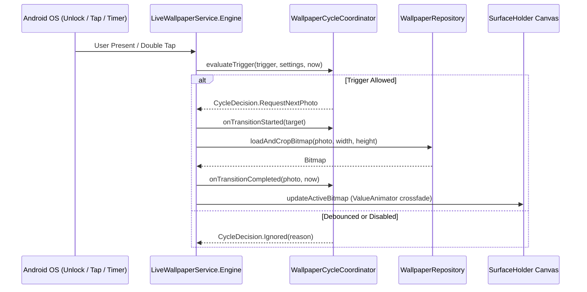

# Live Wallpaper & Background Engine Architecture

## 1. Engine Responsibilities
The wallpaper subsystem manages transitions across several simultaneous triggers:
* Screen unlock (`Intent.ACTION_USER_PRESENT`)
* Screen turned on with interval elapsed (`Intent.ACTION_SCREEN_ON`)
* Double-tap on home screen (`GestureDetector` / `onCommand` / `onTouchEvent`)
* Periodic timer ticks (`drawRunnable` Handler)
* Manual photo selection from Preview tab ("Set as Wallpaper")
* Crop and framing edits from Preview tab
* External synchronization from WorkManager (`WallpaperCycleWorker`)

## 2. Decision Flow via WallpaperCycleCoordinator

## 3. Critical Rules for Engine Modifications
1. **Never bypass `WallpaperCycleCoordinator`**: Any new trigger (e.g. triple-tap, shake, sensor event) must be added as a `CycleTrigger` in `WallpaperCycleCoordinator` with comprehensive unit tests in `WallpaperCycleCoordinatorTest`.
2. **Surface Visibility Awareness**: Do not trigger heavy bitmap loading or cross-fade animations when `isSurfaceVisible` is false; queue the transition via `pendingUnlockCycle` and execute upon `SurfaceVisibilityChanged(visible = true)`.
3. **Black Background Canvas Clearing**: To eliminate dirty swapchain buffer artifacts when switching between orientation or aspect ratios, `drawFrame()` must clear the canvas to `Color.BLACK` before rendering bitmaps.
